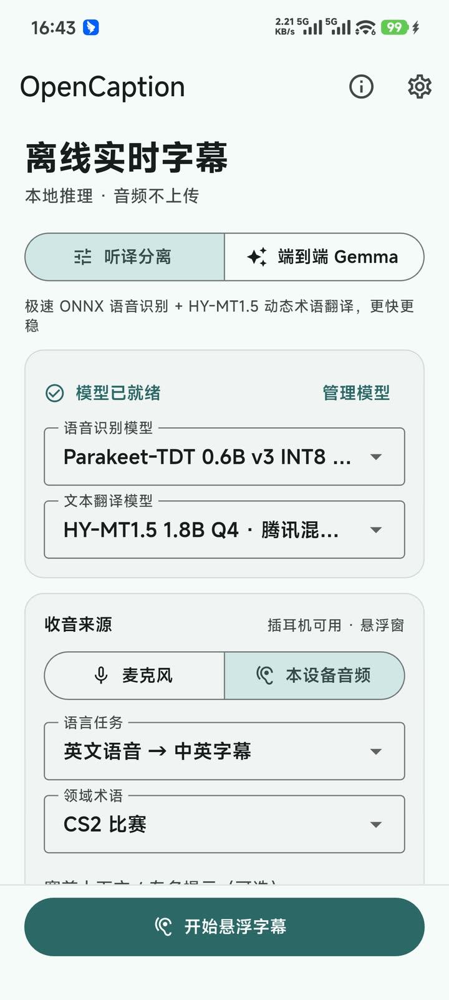
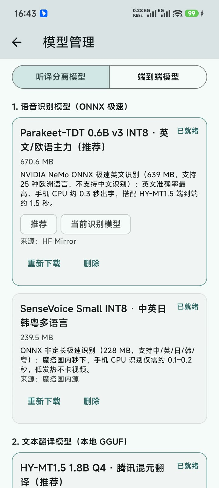
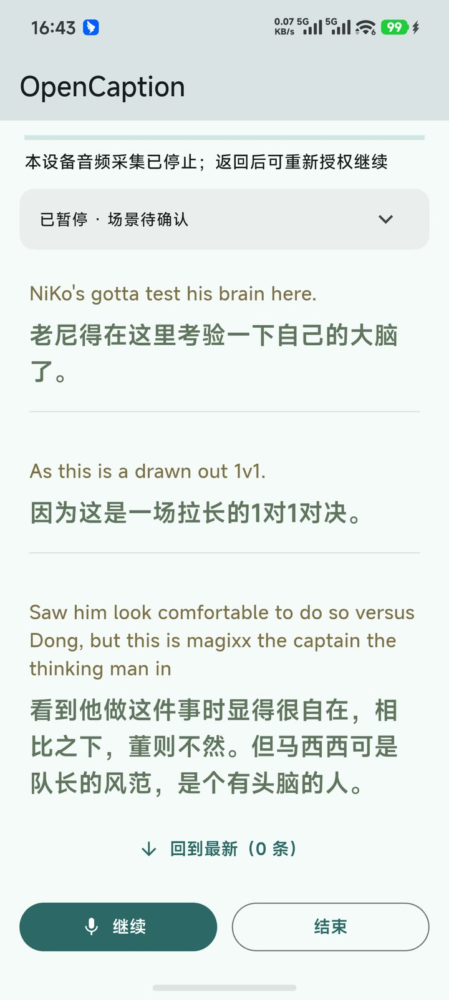

<p align="center">
  
</p>

# OpenCaption

[简体中文](README.zh-CN.md) · [Documentation](docs/README.md) · [License](LICENSE)

OpenCaption is a local-first Android app for real-time bilingual captions. It combines a Flutter UI, Kotlin audio capture and overlay scheduling, and two switchable on-device inference pipelines: a fast **Decoupled ONNX ASR + HY-MT1.5** pipeline (Parakeet-TDT / SenseVoice + Tencent HY-MT1.5-1.8B) and an **End-to-End Gemma 4** pipeline through LiteRT-LM.

> [!NOTE]
> OpenCaption `v0.2.0` ships a local-signed arm64 Android release APK for direct installation and evaluation. Models are downloaded inside the app on first use and run completely offline afterwards.

## Screenshots

<table>
  <tr>
    <td align="center"></td>
    <td align="center"></td>
    <td align="center"></td>
  </tr>
  <tr>
    <td align="center">Session setup</td>
    <td align="center">Offline models</td>
    <td align="center">Live captions</td>
  </tr>
</table>

## What it does

- Runs speech recognition and Chinese translation 100% locally after model setup; raw audio is never persisted or uploaded.
- Supports **two switchable pipelines** inside the main APK:
  - **Decoupled (`ONNX + HY-MT1.5`)**: Fast on-device ONNX ASR (`Parakeet-TDT 0.6B v3 INT8` or `SenseVoice-Small INT8`) paired with `HY-MT1.5-1.8B Q4` for ~1.5–2.5 s end-to-end bilingual captions on modern Snapdragon phones.
  - **End-to-End (`Gemma 4 LiteRT-LM`)**: Single-model multimodal speech understanding with `Gemma 4 E2B` or `E4B`.
- Supports microphone input and Android 10+ playback audio capture (defaulting to full-display capture on Android 14+) with a **2-line rolling floating overlay**, anti-flash reading hold, drag + quick controls (`双语/仅中`, `2行/1行`, `A−/A+`, stop), and persistent preferences.
- Offers English-to-bilingual captions, automatic-language-to-Chinese plus source text, English-only transcription, and Chinese-only transcription.
- Downloads or imports models with expected-size and SHA-256 verification, resumable downloads with live `% · MB/s` speed, fast startup receipt verification, and one-tap cleanup for deprecated legacy models.
- Provides optional scene/name context (including `source=target` custom hints), a CS2 terminology profile with phonetic ASR normalization, **Standard / Natural commentary / Community** translation styles, and a unified 148-player CS2 community nickname catalog (`assets/corpora/cs2_player_nicknames.json`).
- Keeps captions in the current session only. Returning to the home screen clears the transcript.

## Recommended pipelines & models

`gemmaE2E` is the mainline Android build flavor (`OpenCaption`) and includes **both** switchable pipelines:

| Pipeline | Models | Observed latency (Snapdragon 8 Elite) | Best for |
| --- | --- | --- | --- |
| **Decoupled · ONNX + HY-MT** | `Parakeet-TDT 0.6B v3 INT8` (639 MB, recommended) or `SenseVoice-Small INT8` (228 MB) + `HY-MT1.5-1.8B Q4` (1.07 GB) | ASR ~0.2–0.4 s + MT ~1.0–2.5 s | Live English/esports broadcasts, low latency & high accuracy |
| **End-to-End · Gemma 4** | `Gemma 4 E2B` (2.59 GB) or `Gemma 4 E4B` (3.66 GB) via LiteRT-LM `0.17.0` | E2B ~0.6–1.6 s; E4B ~2.6–6 s | Single-model multimodal E2E captioning |

Legacy `cascade` (whisper.cpp) and `qwenE2E` (MNN) build flavors remain in the repository for historical reproducibility, while slow Whisper and legacy Qwen 0.5B/0.8B weights have been removed from the active model catalog (`assets/models.json`).

### Model catalog

- **Parakeet-TDT 0.6B v3 INT8** (~639 MB): Default recommended ASR for English and 25 European languages; pure-Kotlin ONNX Runtime inference.
- **SenseVoice-Small INT8** (~228 MB): Fast multilingual ONNX ASR (Chinese, English, Japanese, Korean, Cantonese) with ModelScope primary mirror.
- **HY-MT1.5-1.8B Q4** (~1.07 GB): Default local Chinese translation model via `llama.cpp` CPU inference with dynamic term injection.
- **Gemma 4 E2B** (~2.59 GB) / **Gemma 4 E4B** (~3.66 GB): LiteRT-LM end-to-end multimodal models (GPU-first with CPU fallback).

Models are downloaded separately inside the app and remain subject to their providers' licenses and terms. They are not covered by this repository's license.

## Using the app

1. Install the `OpenCaption` APK and open **Model Manager** (`模型管理`) to download the models for your chosen pipeline (e.g. `Parakeet-TDT 0.6B v3` + `HY-MT1.5-1.8B` for decoupled mode, or `Gemma 4 E2B` for E2E). Upgrading users can tap **一键清理** to remove obsolete Whisper/Qwen weights.
2. Choose the pipeline, models, speech task, and input source on the home screen (all selections are persisted automatically):
   - **Microphone** captures ambient sound.
   - **This-device audio** uses Android 10+ playback capture and a floating caption overlay (defaults to entire screen on Android 14+). Does not record video; DRM or apps that disallow playback capture may block audio.
3. Optionally enter scene/name context or `A=B` term overrides (up to 240 chars) and select the **CS2** terminology profile for esports broadcasts.
4. In **Settings**, adjust theme, font size (`14–36`, synced live with the floating overlay), source/translation colors, overlay opacity, CPU threads, **translation style** (`Standard`, `Natural commentary`, `Community`), and **Chinese community player nicknames** (configurable in `assets/corpora/cs2_player_nicknames.json`).

## Privacy and limitations

- Default recognition and caption generation run on-device. Raw audio is kept in native memory and is not persisted or uploaded.
- The external Chat Completions-compatible text translation code path is hidden in current product builds. A custom build that enables it sends text to the configured service.
- The first model download requires a network connection. The legacy ML Kit path may also download language packs through Google's SDK.
- Debug builds can expose diagnostics and write timestamped logs to Android public Downloads. Release mode disables that behavior by default. Review logs before sharing them.
- No current APK has completed the required 3 × 60-minute stability run, power and thermal evaluation, held-out quality evaluation, and multi-device validation.

## Development

The local development convention uses:

- JDK 17: `~/Tools/java/eclipse-temurin-jdk17`
- shared LiteRT/LiteRT-LM tools and models: `~/Tools/litert`
- test audio, references, and logs: `~/Downloads/opencaption`

The project wrapper isolates Flutter, Pub, and Gradle state under the repository. The current toolchain is Flutter 3.47.2, Dart 3.13.2, JDK 17, Android SDK 36, NDK 28.2.13676358, and CMake 3.22.1. The minimum Android API is 28, and only `arm64-v8a` is built.

```bash
export OPENCAPTION_JAVA_HOME="$HOME/Tools/java/eclipse-temurin-jdk17"
python3 scripts/fetch_native.py
scripts/flutterw pub get
scripts/flutterw analyze --no-pub
scripts/flutterw test --no-pub
```

Native revisions are pinned in `native.lock.json`. After changing `pigeons/engine.dart`, regenerate the bridge:

```bash
PUB_CACHE="$PWD/.pub-cache" .tools/flutter/bin/dart --suppress-analytics \
  run pigeon --input pigeons/engine.dart
```

## Building an APK

The build script enforces arm64 and verifies the configured signing fingerprint so test APK upgrades retain app-private model files:

```bash
# Debug test APK with diagnostics enabled by default
scripts/build-apk gemmaE2E

# Release-mode test APK; still not a store-signed package
OPENCAPTION_BUILD_MODE=release \
OPENCAPTION_DIAGNOSTICS=false \
scripts/build-apk gemmaE2E
```

`cascade` and `qwenE2E` can be built in the same way. Output is written under `build/app/outputs/flutter-apk/`. Release builds currently leave R8 and resource shrinking disabled until LiteRT-LM reflection and native binding keep rules are complete and device-tested.

Run tests and builds serially. Do not load multiple large models concurrently.

## LiteRT-LM evaluation

Linux CPU evaluation uses the shared LiteRT-LM environment and an explicit cgroup memory limit:

```bash
scripts/setup-gemma-eval
scripts/fetch-gemma-litert

OPENCAPTION_MEMORY_MAX_MB=6144 scripts/run-gemma-eval \
  "$HOME/Downloads/opencaption/clip.wav" \
  --model "$HOME/Tools/litert/models/gemma-4-E2B-it.litertlm" \
  --speculative-decoding=true \
  --cache-mode=memory \
  --warmup=1 \
  --max-context-tokens=768
```

The runner uses systemd `MemoryHigh`/`MemoryMax` with swap disabled. Do not replace the real memory limit with `ulimit -v`; mapped address space is not resident memory. Results include raw model output, parser status, per-window inference time, RTF, and peak RSS.

## Documentation

- [Design overview](docs/design.md)

## Contributing and security

See [CONTRIBUTING.md](CONTRIBUTING.md) before opening a pull request. Report sensitive vulnerabilities according to [SECURITY.md](SECURITY.md), not through a public issue.

## License

Original project material is available under the [PolyForm Noncommercial License 1.0.0](LICENSE). Commercial use is not permitted by that license.

This is a **source-available** license, not an OSI-approved open-source license. Third-party software, models, and data retain their own terms; see [THIRD_PARTY_NOTICES.md](THIRD_PARTY_NOTICES.md).
