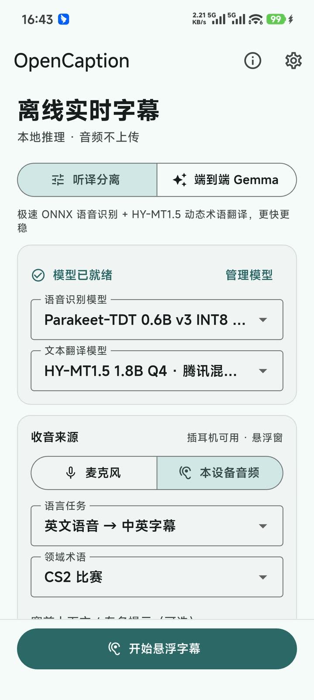
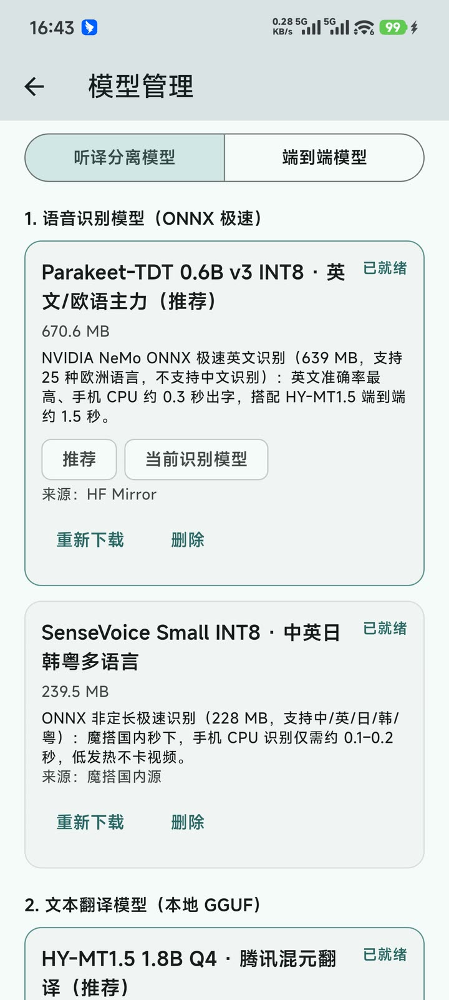
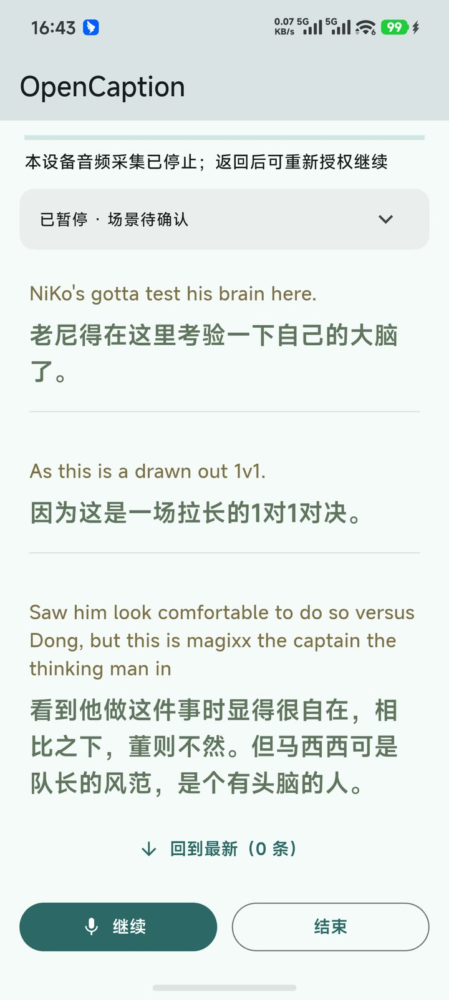

<p align="center">
  
</p>

# OpenCaption

[English](README.md) · [文档导航](docs/README.md) · [许可证](LICENSE)

本地优先的 Android 离线实时双语字幕应用。内置**听译分离（ONNX 语音识别 + 腾讯 HY-MT1.5 本地翻译）**与**端到端（Gemma 4 LiteRT-LM）**双管线，支持麦克风及本设备播放音频捕获、悬浮窗双行滚动字幕与 CS2 电竞解说术语/选手外号优化，模型准备完成后可完全断网运行。

`v0.2.0` 发布包采用本地固定签名（arm64），可直接安装与覆盖升级，适合实机日常使用与持续评测；非应用商店签名包。

## 截图

<table>
  <tr>
    <td align="center"></td>
    <td align="center"></td>
    <td align="center"></td>
  </tr>
  <tr>
    <td align="center">会话设置</td>
    <td align="center">离线模型</td>
    <td align="center">实时字幕</td>
  </tr>
</table>

## 双管线与推荐模型

主线 `gemmaE2E` 构建（应用名 `OpenCaption`）同时内置两条可随时切换的本地推理管线：

| 管线 | 推荐模型组合 | 实测参考耗时（骁龙 8 Elite） | 适用场景 |
| --- | --- | --- | --- |
| **听译分离 · ONNX + HY-MT** | `Parakeet-TDT 0.6B v3 INT8`（639 MB，英文主力推荐）或 `SenseVoice-Small INT8`（228 MB，中英日韩粤） + `HY-MT1.5-1.8B Q4`（1.07 GB） | ASR 约 0.2–0.4 s + 翻译 约 1.0–2.5 s | 英文直播/CS2 赛事解说实时双语字幕（低延迟、高准确） |
| **端到端 · Gemma 4** | `Gemma 4 E2B`（2.59 GB）或 `Gemma 4 E4B`（3.66 GB），LiteRT-LM `0.17.0` | E2B 约 0.6–1.6 s；E4B 约 2.6–6 s | 单模型端到端语音理解与中英输出 |

旧的 `cascade`（whisper.cpp）与 `qwenE2E`（MNN）flavor 仍保留在仓库以便历史对照；慢速 Whisper 与旧版 Qwen 0.5B/0.8B 权重已从活跃模型目录（`assets/models.json`）移除，老版本用户可在模型管理页点击**「一键清理」**释放空间。

### 模型目录

- **Parakeet-TDT 0.6B v3 INT8（639 MB）**：英文及 25 种欧洲语言识别准确率最高、手机 CPU 约 0.3 s 出字，听译分离默认推荐。
- **SenseVoice-Small INT8（228 MB）**：支持中/英/日/韩/粤多语种，魔搭国内镜像直连，手机 CPU 约 0.2 s 出字。
- **HY-MT1.5-1.8B Q4（1.07 GB）**：腾讯混元翻译模型（CPU 稳定推理，避免移动端 Vulkan 乱码），支持动态术语注入与风格控制。
- **Gemma 4 E2B（2.59 GB） / E4B（3.66 GB）**：LiteRT-LM 端到端多模态模型（GPU 优先，失败回退 CPU）。

## 使用方式

1. 安装 `OpenCaption` APK，进入右上角**「模型管理」**下载所需模型（听译分离推荐 `Parakeet-TDT` + `HY-MT1.5`，端到端推荐 `Gemma 4 E2B`）。下载支持断点续传、实时 `% · MB/s` 速率显示、SHA-256 校验与毫秒级启动复检；若手机残留旧版淘汰模型，可直接点**「一键清理」**释放空间。
2. 在首页选择推理管线、模型、语音任务、术语库与输入方式（所有配置自动记忆，下次启动沿用）：
   - **麦克风**：采集外放环境音。
   - **本设备音频**：Android 10+ 播放音频捕获 + 悬浮字幕（Android 14+ 默认直接共享整个屏幕，无需每次切换「单个应用」；不录制画面，部分 DRM/通话/禁止共享音频的 App 可能无法采集）。
3. 悬浮窗支持**双行滚动历史**与防闪烁最短停留、整窗拖动、轻点展开快捷条（`双语/仅中`、`2行/1行`、`A−/A+`、`停止`），字号与开关状态自动持久化并与设置页双向同步。
4. 可在首页填写场景/人名或 `A=B` 自定义映射提示词；选择 **CS2 词库**后自动启用 60+ 职业选手音近纠错、解说高频术语注入与 5 分钟赛场记忆。
5. 在**「设置」**中可调节主题、字幕字号（`14–36`，应用内与悬浮窗同步）、原文/译文颜色、悬浮窗透明度、CPU 线程，以及**翻译风格**（标准 / 自然解说 / 社区趣味）与**选手中文社区外号**（统一由 [cs2_player_nicknames.json](assets/corpora/cs2_player_nicknames.json) 配置，覆盖 148 位收录选手，支持多外号轮换）。

## 隐私与已知边界

- 默认识别和字幕处理都在设备内完成，不上传音频；字幕只保留在当前会话，返回首页后清除。
- 当前产品构建默认隐藏外部文本翻译入口。代码保留未来启用的 Chat Completions 兼容协议、HTTPS 默认和安全存储配置，但不能把它当作当前可用功能。
- 模型首次下载需要网络；ML Kit 语言包由 Google SDK 管理，应用不能替换其下载源。离线测试应在模型准备完成后开启飞行模式。
- Debug 测试包默认开启诊断面板，并在 Android 公共 `Downloads` 写入时间命名日志；Release mode 默认关闭诊断和日志。日志不记录音频、字幕、API Key 或完整模型路径。
- 当前 APK 尚未完成 3×60 分钟无崩溃、功耗、温升、保留集质量和多机兼容验收；不要把单次金标结果或手机延迟范围当作发布承诺。

## 开发环境

项目约定的非仓库路径：

- JDK 17：`~/Tools/java/eclipse-temurin-jdk17`
- LiteRT-LM 公共环境和模型：`~/Tools/litert`
- 音频、金标和运行日志：`~/Downloads/opencaption`

项目自带 Flutter wrapper 使用 `.tools/flutter` 和隔离的 `.pub-cache`／Gradle cache。当前工具链为 Flutter 3.47.2、Dart 3.13.2、JDK 17、Android SDK 36、NDK 28.2.13676358、CMake 3.22.1；最低 Android API 28，仅构建 `arm64-v8a`。

```bash
export OPENCAPTION_JAVA_HOME="$HOME/Tools/java/eclipse-temurin-jdk17"
python3 scripts/fetch_native.py
scripts/flutterw pub get
scripts/flutterw analyze --no-pub
scripts/flutterw test --no-pub
```

原生引擎版本固定在 `native.lock.json`；修改 `pigeons/engine.dart` 后重新生成桥接代码：

```bash
PUB_CACHE="$PWD/.pub-cache" .tools/flutter/bin/dart --suppress-analytics \
  run pigeon --input pigeons/engine.dart
```

## 构建 APK

构建脚本强制 arm64，并校验固定签名指纹，避免覆盖安装时因签名变化丢失应用私有模型：

```bash
# Debug：默认开启诊断指标和测试日志
scripts/build-apk gemmaE2E

# Release mode：关闭诊断；仍是本地测试签名，不是商店发布包
OPENCAPTION_BUILD_MODE=release \
OPENCAPTION_DIAGNOSTICS=false \
scripts/build-apk gemmaE2E
```

也可以构建 `cascade` 或 `qwenE2E`。输出位于 `build/app/outputs/flutter-apk/`。release 暂不启用 R8／资源缩减，因为 LiteRT-LM 的反射和原生绑定仍需先补齐 keep 规则并实机验证。测试和构建请串行执行；不要同时加载多个大型模型。

## LiteRT-LM 本机评测

本机评测使用 LiteRT-LM Linux CPU，环境和模型统一放在 `~/Tools/litert`，音频和金标统一放在 `~/Downloads/opencaption`：

```bash
scripts/setup-gemma-eval
scripts/fetch-gemma-litert

# 5 秒窗口、MTP、768 context、memory cache、1 个 warmup 的示例
OPENCAPTION_MEMORY_MAX_MB=6144 scripts/run-gemma-eval \
  "$HOME/Downloads/opencaption/clip.wav" \
  --model "$HOME/Tools/litert/models/gemma-4-E2B-it.litertlm" \
  --speculative-decoding=true \
  --cache-mode=memory \
  --warmup=1 \
  --max-context-tokens=768
```

`scripts/run-gemma-eval` 使用 systemd cgroup 的 `MemoryHigh`／`MemoryMax` 限制实际内存并禁用 swap，默认上限为 6 GiB，允许通过 `OPENCAPTION_MEMORY_MAX_MB` 调低。不要用 `ulimit -v` 代替实际内存限制；mmap 地址空间和进程常驻内存不是同一个指标。评测脚本会记录每窗口原始输出、解析状态、推理时间、RTF 和峰值 RSS。

实验过程、开发计划、检查点和本机评测报告统一保存在不纳入版本控制的 `docs/dev/`，不作为公开文档的链接目标。

## 项目文档

- [文档导航](docs/README.md)
- [简明设计与架构说明](docs/design.md)
- [评测工具说明](evaluation/README.md)
- [版本变更](CHANGELOG.md)

## 贡献、安全与许可证

提交改动前请阅读 [CONTRIBUTING.md](CONTRIBUTING.md)；涉及音频、字幕、凭据、模型完整性或设备数据的安全问题请按 [SECURITY.md](SECURITY.md) 私下报告。

项目原创内容使用 [PolyForm Noncommercial License 1.0.0](LICENSE)，不允许商业用途。该许可证属于**源码可见（source-available）**许可证，不是 OSI 认可的开源许可证。第三方软件、模型和数据仍适用各自条款，详见 [THIRD_PARTY_NOTICES.md](THIRD_PARTY_NOTICES.md)。
